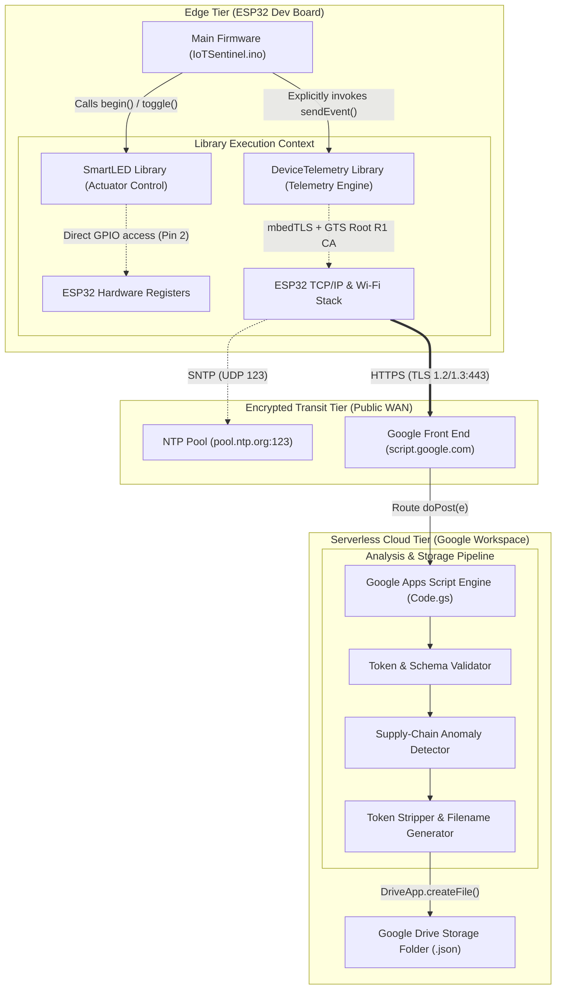
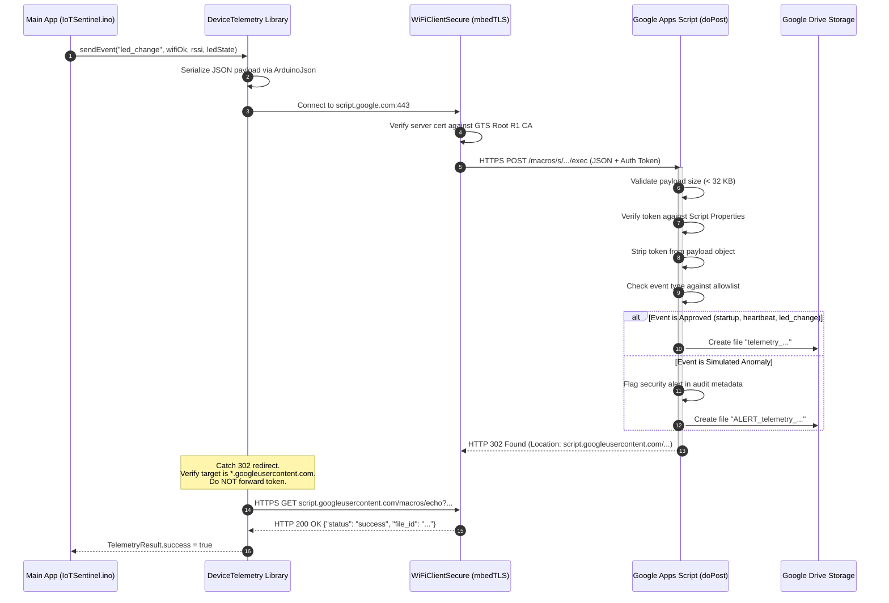

# System Architecture — IoT Sentinel Supply-Chain Lab

This document details the architectural design, component modularity, sequence workflows, and trust models of the **IoT Sentinel** research testbed.

---

## 1. System Topology & Trust Domains

The research testbed is structured into three discrete execution tiers:



---

## 2. Experimental Configurations

To investigate the research question, the firmware supports three compile-time configurations in [`config.h`](file:///home/sherlock/.gemini/antigravity-ide/scratch/IoT-Sentinel/firmware/IoTSentinel/config.h):

```
+---------------------------------------------------------------------------------+
|                        RESEARCH EXPERIMENT CONFIGURATIONS                       |
+---------------------------------------------------------------------------------+
| Configuration A : Baseline (Zero Telemetry)                                     |
|                   - SmartLED active (GPIO 2 toggling)                           |
|                   - Wi-Fi associated and clock synced                           |
|                   - DeviceTelemetry library NOT instantiated                     |
|                   - Expected Network Traffic: DHCP + NTP only. Zero HTTPS.      |
+---------------------------------------------------------------------------------+
| Configuration B : Approved Telemetry                                            |
|                   - SmartLED active                                             |
|                   - DeviceTelemetry instantiated with explicit parameters       |
|                   - Approved Events: 'startup', 'heartbeat' (60s), 'led_change' |
|                   - Expected Network Traffic: TLS sessions strictly to Google   |
+---------------------------------------------------------------------------------+
| Configuration C : Simulated Compromised Dependency                              |
|                   - SmartLED active                                             |
|                   - DeviceTelemetry active                                      |
|                   - Injects synthetic unexpected event ('simulated_anomaly')    |
|                   - Cloud pipeline flags event with 'ALERT_' prefix in Drive    |
|                   - Wireshark captures multiple TLS handshakes per user action  |
+---------------------------------------------------------------------------------+
```

---

## 3. Telemetry Sequence & Google Redirection Flow

The following sequence diagram illustrates how telemetry is transmitted, validated, and stored:



---

## 4. Software Modularity & Architectural Isolation

In Arduino embedded development, C++ libraries run in the **same address space and privilege level** as the main application. There is no memory segmentation, user/kernel space separation, or capability-based security model.

* **SmartLED**: Pure hardware actuator abstraction. Encapsulates GPIO initialization, level inversion (active-high/low), and state queries. Contains no network dependencies.
* **DeviceTelemetry**: Application-layer network client. Encapsulates `WiFiClientSecure`, `HTTPClient`, and `ArduinoJson`. Enforces Google GTS Root R1 certificate validation and domain-validated redirect handling.
* **Main Application (`IoTSentinel.ino`)**: Coordinates state between the actuator and the telemetry engine.
